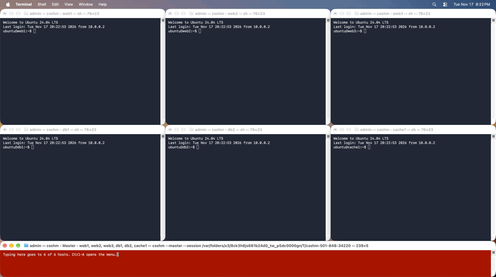
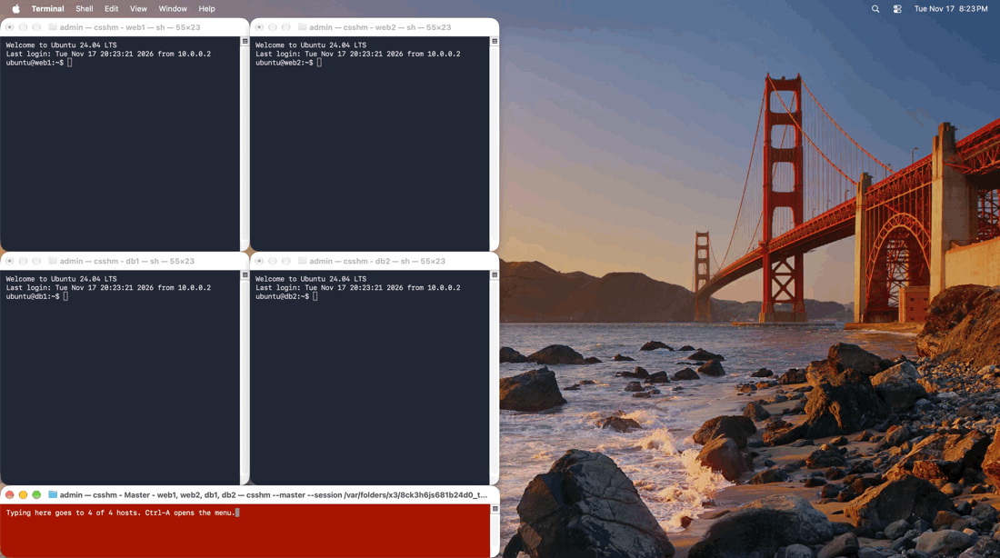
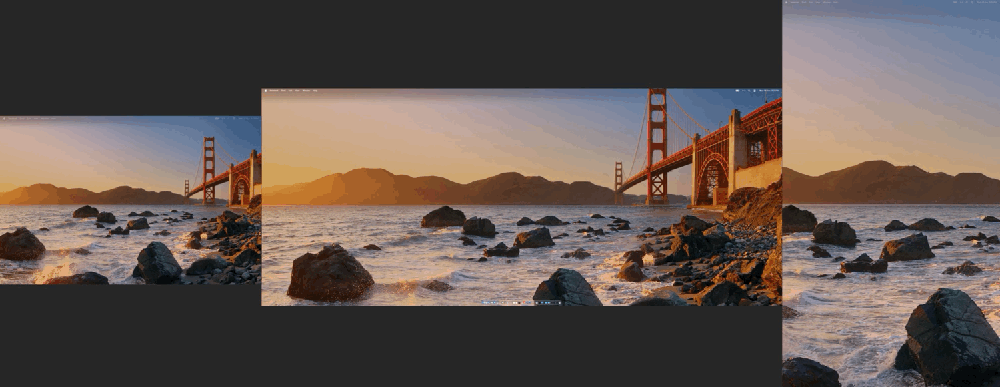
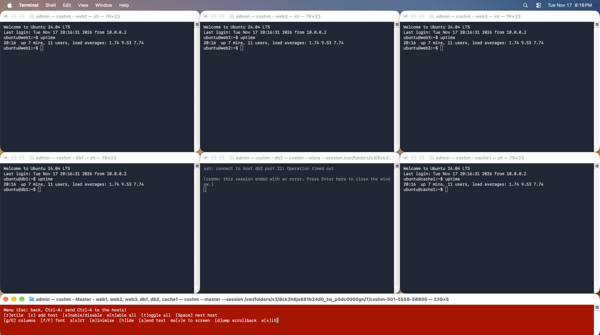
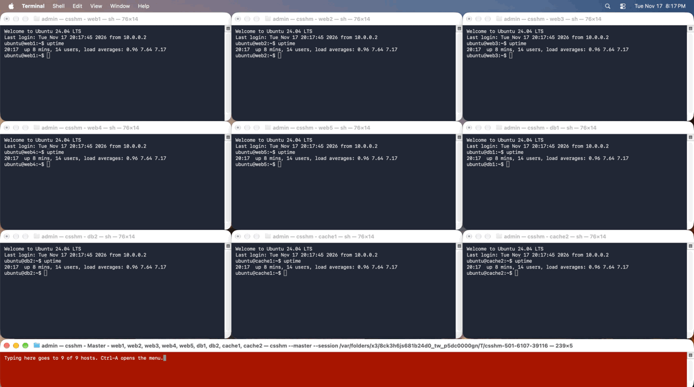
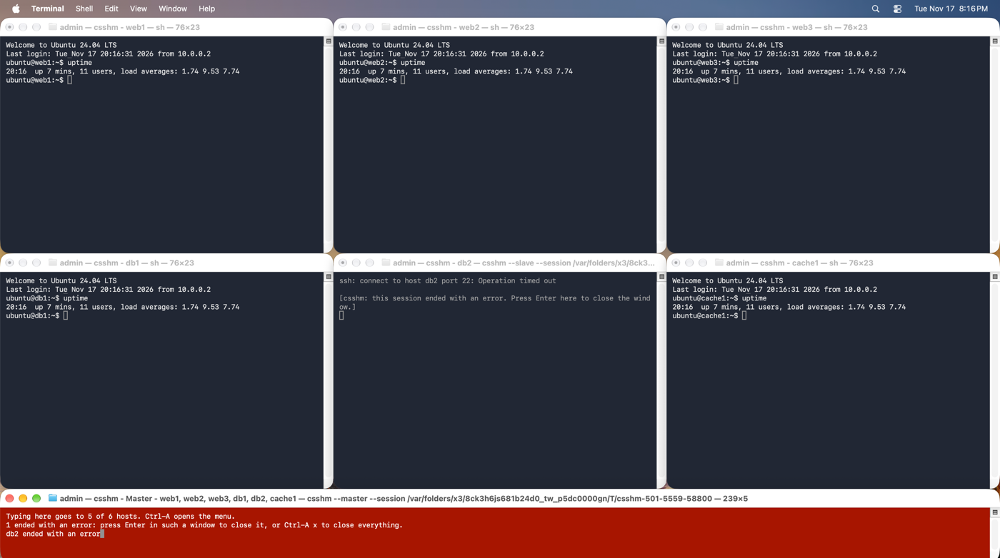

# csshm

Cluster SSH for macOS: type once and it goes to many SSH sessions at the same time.

csshm is not limited to ssh (see below [Containers, pods and other commands](#containers-pods-and-other-commands))

csshm opens one Terminal window per host, tiles them across your monitors
and adds a red master window. Whatever you type in the master goes to every
host. Click a host window and type and it goes only to that host.

It is written in Swift and inspired by [csshX](https://github.com/brockgr/csshx)
and by ClusterSSH on Linux. It takes the same command line as csshX.

## What it does

- Sends what you type to every server at once or to one server when you click
  its window.
- Tiles dozens of windows across one or several monitors, portrait ones
  included and tiles them again when you ask.
- Keeps to part of a monitor if you want the rest free (`--bounds`) and shows
  which number each monitor has (`--list_screens`).
- Keeps a failed connection open so you can read the error and tries those
  servers again with one key while the others stay connected.
- Takes hosts from the command line, from files, from named clusters or from
  another command's output.
- Takes the same command line as csshX, so old habits and scripts carry over.
- Is not limited to ssh: a command template runs `docker exec`, `kubectl exec`
  or anything else in each window.
- Passes chosen environment variables such as `AWS_PROFILE` to every window,
  for AWS SSM and similar setups.
- Works with zsh, bash, fish and sh as your login shell.
- Never stores or sends passwords.
- Is one file with nothing else to install, for both Apple silicon and Intel
  Macs.

## Quick start

Install it:

    curl -fsSL https://raw.githubusercontent.com/anarchy89/csshm/main/setup.sh | sh

Open a window for each server:

    csshm web1 web2 web3

Then:

- Type in the red master window and every server receives it.
- Click a server's window and type to reach only that one.
- Press Ctrl-A in the red window for the menu. Ctrl-A then `x` closes everything.
- If some servers could not be reached, perhaps because they were still
  starting up, press Ctrl-A then `a` to try just those again. The others
  stay connected.

The most common variations:

    csshm --login ubuntu web1 web2 web3              # same user on every server
    csshm --ssh_args "-i ~/.ssh/key" web1 web2       # same key on every server
    csshm --addresses servers.txt                    # servers from a file, one per line
    csshm --screen 1-3 --addresses servers.txt       # spread across monitors 1 to 3
    csshm ubuntu@10.0.0.1 admin@10.0.0.2:2222        # user and port for each server

They can be combined:

    csshm --login ubuntu --ssh_args "-i ~/.ssh/key" --addresses servers.txt

Hosts can also come from another command, such as every EC2 instance that
is running:

    aws ec2 describe-instances --filters "Name=instance-state-name,Values=running" \
        --query "Reservations[].Instances[].PrivateIpAddress" --output text \
        | tr '\t' '\n' | csshm --login ec2-user

More in [Putting options together](#putting-options-together).

That is all most people need. Run `csshm --help` for a summary or read on for
the details. Homebrew users can install with `brew` instead: see
[Install / update / uninstall](#install--update--uninstall).

## About

I wrote it because csshX is no longer maintained. It relies on Perl libraries
that Apple has stopped maintaining on macOS, which leads to some odd bugs.

I also built it to make life a little easier. I hope people use it and I
plan to maintain it for the foreseeable future.

**Why not an orchestration tool?** Tools like Ansible run a command and hand
you the result. They are the right choice for a change you already
understand and want to repeat, unattended.

csshm is for work you do by hand. Anything you would do at a terminal on one
server, you can do on many at once and watch all of them live: start a
Python script on every machine and see each one's output as it runs, launch
a machine learning job across a set of GPU boxes and keep an eye on every
one, tail logs during a deploy, install and check a package or track down
why three servers out of forty behave differently. You see what each machine
is doing as it does it, you can answer a prompt or stop one that goes wrong
and you can click into a single window to do something on that machine
alone.

Status: early. It works in testing with dozens of windows, but has not yet
had wide use. Please report problems: see
[Known and possible bugs](#known-and-possible-bugs) for what helps.

## Contents

- [What it does](#what-it-does)
- [Quick start](#quick-start)
- [Requirements](#requirements)
- [Install / update / uninstall](#install--update--uninstall)
- [Giving hosts](#giving-hosts)
- [Options](#options)
- [Putting options together](#putting-options-together)
- [Containers, pods and other commands](#containers-pods-and-other-commands)
- [Environment variables](#environment-variables)
- [Settings file and clusters](#settings-file-and-clusters)
- [Monitors and the grid](#monitors-and-the-grid)
- [The master window and its menu](#the-master-window-and-its-menu)
- [Choosing which hosts receive your typing](#choosing-which-hosts-receive-your-typing)
- [When a session ends](#when-a-session-ends)
- [Keys and passwords](#keys-and-passwords)
- [Security](#security)
- [Coming from csshX](#coming-from-csshx)
- [Troubleshooting](#troubleshooting)
- [Known and possible bugs](#known-and-possible-bugs)
- [How it works](#how-it-works)
- [Development](#development)
- [License](#license)

## Requirements

- macOS 13 or later. Development and testing so far have been on macOS 27.
- Terminal.app. Other terminal applications are not supported.
- To build from source: Xcode or the Swift toolchain.

## Install / update / uninstall

    curl -fsSL https://raw.githubusercontent.com/anarchy89/csshm/main/setup.sh | sh

This downloads the latest release, checks that it runs and puts it in
`/usr/local/bin`, asking for your password if that folder needs it. csshm is
one file, for both Apple silicon and Intel Macs, with nothing else to install.

To do the same by hand:

    curl -L -o csshm https://github.com/anarchy89/csshm/releases/latest/download/csshm
    chmod +x csshm
    sudo mkdir -p /usr/local/bin
    sudo mv csshm /usr/local/bin/

The binary is not signed with an Apple developer certificate. Downloaded with
`curl` as above, it runs. Downloaded with a web browser, macOS refuses to
open it until you clear the download mark:

    xattr -d com.apple.quarantine csshm

### With Homebrew

    brew tap anarchy89/tap
    brew trust anarchy89/tap
    brew install csshm

`brew trust` is needed on Homebrew 7 and later, which does not load formulae
from a tap until you say you trust it. On older versions leave that line out.
Homebrew builds csshm from source, so Xcode must be installed.

Update with `brew upgrade csshm` and remove with `brew uninstall csshm`.

### Update

    csshm --update

This checks the latest release and replaces the installed csshm if the
release is newer. It asks for your password when the folder needs it. A
copy installed with Homebrew is updated with `brew upgrade csshm` instead.

### Uninstall

If you installed with the install line or by hand:

    sudo rm /usr/local/bin/csshm

If you installed with Homebrew:

    brew uninstall csshm
    brew untap anarchy89/tap

The second Homebrew line removes the tap, so Homebrew stops checking it for
updates. Leave it out if you may install csshm again.

Either way, your settings file stays, if you made one. To remove it too:

    rm -rf ~/.config/csshm

csshm keeps nothing else on your Mac.

### Build from source

This needs Xcode or the Swift toolchain.

    git clone https://github.com/anarchy89/csshm
    cd csshm
    swift build -c release
    sudo cp .build/release/csshm /usr/local/bin/

## Giving hosts

### How to write a host

| Form | Example | Meaning |
|---|---|---|
| `host` | `10.0.0.5`, `web1` | The address or name. A name from `~/.ssh/config` works, because csshm runs the real `ssh` |
| `host:port` | `10.0.0.5:2222` | With a port |
| `user@host` | `ubuntu@10.0.0.5` | With a user |
| `user@host:port` | `ubuntu@10.0.0.5:2222` | With both |
| `user,host` | `ubuntu,10.0.0.5` | The same as `user@host` |
| `user,host:port` | `ubuntu,10.0.0.5:2222` | The same as `user@host:port` |
| `user@host,KEY` | `admin@10.0.0.5,~/.ssh/key-b` | With a private key for this host only |
| `user,host,KEY` | `admin,10.0.0.5,~/.ssh/key-b` | The same |
| `,host,KEY` | `,10.0.0.5,~/.ssh/key-b` | A key for this host, with the `--login` user |
| `[ipv6]:port` | `[fe80::1]:2222` | IPv6 with a port. A bare `fe80::1` also works |

The `@` and comma forms can be mixed freely. Rules worth knowing:

- A user written with a host wins over `--login`.
- The user comes first: `ubuntu,10.0.0.5`, not `10.0.0.5,ubuntu`.
- No spaces inside a host: write `ubuntu,10.0.0.5`, not `ubuntu, 10.0.0.5`.
- A key path cannot contain a comma or a space.
- A host name may contain letters, digits, dots, dashes and underscores (plus
  colons and `%` for IPv6). A user may also contain `+`, `@` and `\`.
  Anything else is refused, including control characters.
- If any host is written wrongly, csshm names it and opens nothing.
- The same host listed twice opens two windows.

### Where hosts can come from

As arguments:

    csshm --login ubuntu 10.0.0.1 10.0.0.2 10.0.0.3
    csshm --login ubuntu $(< servers.txt)

From a file, with `--addresses` (or `--hosts`, which means the same):

    csshm --login ubuntu --addresses servers.txt

From standard input:

    cat servers.txt | csshm --login ubuntu
    csshm --login ubuntu < servers.txt

Standard input is read only when no hosts are given as arguments and no file
is named. To combine a file with extra hosts, name the file:
`csshm --addresses servers.txt 10.0.0.9`. `--addresses` may be repeated and
`--addresses -` reads standard input explicitly.

### The file format

One host per line, in any of the forms above.

    # production web servers
    10.0.0.1
    10.0.0.2                      # a comment can follow a host
    admin,10.0.0.3
    root@10.0.0.4:2222
    ubuntu,10.0.0.5,~/.ssh/key-b

    10.0.0.6   tail -f /var/log/syslog

- `#` starts a comment. Blank lines are skipped.
- Text after a host, separated by a space, is a command to run on that host
  in place of a login shell. It overrides `--remote_command` for that host.
- There is no header row and there are no other columns.
- A file saved on Windows, with its line endings, works too.

## Options

| Option | Meaning |
|---|---|
| `-l`, `--login USER` | User to log in as, for hosts that do not name one |
| `--ssh_args ARGS` | Extra arguments for ssh, given as one quoted string, for example `"-i ~/.ssh/key -o ConnectTimeout=5"`. They apply to every host. Quotes inside the string are respected; `~` is left for ssh to expand |
| `--screen SPEC` | Monitors to use. See [Monitors and the grid](#monitors-and-the-grid) |
| `--hosts FILE`, `--addresses FILE` | Read hosts from a file. `-` means standard input. May be repeated |
| `--remote_command CMD` | Command to run on every host in place of a login shell. The window closes when the command finishes |
| `--remote_command_keepalive CMD` | The same, but each window stays open after the command finishes so its output can be read. See [When a session ends](#when-a-session-ends) |
| `--ssh COMMAND` | Program to run instead of `ssh`. It receives the same arguments ssh would |
| `--env NAME`, `--env NAME=VALUE` | Pass an environment variable from the shell you are in to every host window or set one directly. May be repeated. See [Environment variables](#environment-variables) |
| `--command TEMPLATE` | Run this in each window in place of ssh, with `{}` standing for the host. See [Containers, pods and other commands](#containers-pods-and-other-commands) |
| `--master_screen N` | Monitor for the red master window. The default is 1 |
| `--bounds AREA` | Keep the windows to part of a monitor. `AREA` is `SCREEN:X1,Y1-X2,Y2`, for example `2:0,30-1720,1400`. May be repeated, once per monitor. See [Using part of a monitor](#using-part-of-a-monitor) |
| `--retile MODE` | `manual` (the default): a closed window leaves a gap until Ctrl-A `r`. `auto` (experimental): the windows re-tile by themselves when a session ends |
| `-x`, `--tile_x N` | Fixed number of columns on each monitor |
| `-y`, `--tile_y N` | Fixed number of rows on each monitor. Ignored if `--tile_x` is given. For either, 0 means automatic and switches off a number from the settings file |
| `--profile NAME` | Terminal profile for the host windows, for example one with a small font or the bell switched off. `--slave_settings_set` and `--sss` mean the same |
| `--master_profile NAME` | Terminal profile for the master window. `--master_settings_set` and `--mss` mean the same |
| `--font_size N` | Font size for the host windows |
| `--menu_key KEY` | Key that opens the menu, written like `ctrl-b`. The default is Ctrl-A |
| `--config FILE` | Settings file to read instead of `~/.config/csshm/config.toml` |
| `--list_clusters` | Print the names of the clusters in the settings file and exit |
| `--list_screens` | Print each monitor's number, name, size and place and the area free for `--bounds`, then exit |
| `--debug` | Show the command each window runs and leave windows open when their session ends |
| `--update` | Replace this csshm with the latest release, if that is newer |
| `-h`, `--help` | Show the built-in help |
| `-v`, `--version` | Show the version |

Options may be written `--name VALUE` or `--name=VALUE`, with one dash or
two and shortened to any unique prefix (`--scr 2`).

Each host's session is started as:

    ssh [-i KEY] [ssh_args] [-l USER] [-p PORT] HOST [COMMAND]

unless `--command` is given, in which case the template is run instead.

## Putting options together

Options can be combined freely and given in any order. These are situations
that come up in real use, with the command for each.

**Your usual fleet.** Servers listed in a file, one user and key for all of
them, spread over two monitors.

    csshm --login ubuntu --ssh_args "-i ~/.ssh/key" --addresses servers.txt --screen 2-3

**A laptop on a desk with two big monitors.** The servers fill the big
monitors and the red window sits on the laptop, so nothing on the big
monitors gives up room for it.

    csshm --addresses servers.txt --screen 2-3 --master_screen 1

**Thirty or forty servers at once.** Use every monitor and smaller text so
each window still shows a useful amount.

    csshm --login ubuntu --addresses servers.txt --screen 1-4 --font_size 9

**Watching the logs on every web server during a deploy.** Each window runs
the command in place of a login shell.

    csshm --login ubuntu --remote_command "tail -f /var/log/nginx/error.log" --addresses web.txt --screen 2-3

**Checking disk space across the fleet.** Each window runs the command and
stays open afterwards, so you can compare the answers side by side.

    csshm --login ubuntu --remote_command_keepalive "df -h /" --addresses servers.txt --screen 2-3

**The running EC2 instances with one tag**, here the web servers, on two
monitors. Any command that prints hosts can feed csshm: hosts are read from
standard input when none are named.

    aws ec2 describe-instances \
        --filters "Name=tag:Role,Values=web" "Name=instance-state-name,Values=running" \
        --query "Reservations[].Instances[].PrivateIpAddress" --output text \
        | tr '\t' '\n' | csshm --login ec2-user --screen 2-3

**Private servers behind a bastion.** Anything ssh accepts can go in
`--ssh_args`, here a jump host.

    csshm --login ubuntu --ssh_args "-J bastion.example.com" --addresses private.txt

**EC2 instances with no ssh at all**, through AWS Session Manager, using the
AWS profile from your shell.

    csshm --env AWS_PROFILE=prod --command "aws ssm start-session --target {}" --screen 2 i-0518b235de43acdcd i-0ba5ca0c58dbfeebb

**A shell in every pod of a deployment.**

    kubectl get pods -l app=web --no-headers -o custom-columns=:metadata.name \
        | csshm --command "kubectl exec -it {} -- sh" --screen 2

**The web and database servers together**, from clusters named in the
settings file.

    csshm web db --screen 2-3

**A runbook or a dashboard beside the session.** csshm keeps to the left half
of the monitor and the rest stays free for the browser.

    csshm --addresses servers.txt --bounds 1:0,30-860,900 --tile_x 2

**Servers where you live inside GNU screen**, which needs Ctrl-A for itself.
Move csshm's menu to another key.

    csshm --menu_key ctrl-b --addresses servers.txt --screen 2

Anything you use every time can go in the
[settings file](#settings-file-and-clusters), which leaves the command short:
with `login`, `ssh_args` and `screen` set there, the first example becomes
`csshm --addresses servers.txt`.

Two things do not combine: `--command` replaces ssh, so it cannot go with
`--ssh`, `--ssh_args` or `--remote_command` and `--tile_y` is ignored when
`--tile_x` is given.

## Containers, pods and other commands

csshm is not limited to ssh. `--command` takes any command, written once
with `{}` where the name of each target goes and runs it in every window:

    csshm --command "docker exec -it {} sh" web db cache

Typing in the master then goes to every container, exactly as with ssh hosts.

Some recipes:

    # every running Docker container (podman works the same way)
    csshm --command "docker exec -it {} sh" $(docker ps --format '{{.Names}}')

    # every pod matching a label
    csshm --command "kubectl exec -it {} -- sh" \
        $(kubectl get pods -l app=web -o custom-columns=:metadata.name --no-headers)

    # pods in another namespace
    csshm --command "kubectl -n prod exec -it {} -- bash" api-1 api-2 api-3

    # Tart virtual machines are ordinary ssh hosts
    csshm --login admin $(tart ip vm1) $(tart ip vm2)

How the template works:

- `{}` is the host name. `{user}` is the user given with the host or with
  `--login`. `{port}` is the port given with the host.
- The template is split into words the way a shell would split it, then run
  directly with no shell in between. Quote a part to keep it as one word:
  `--command "sh -c 'echo {}; exec nc {} 23'"`.
- A placeholder can sit inside a word, as in `pod/{}`.
- Target names follow the same rules as host names: letters, digits, dots,
  dashes and underscores. A name cannot add extra words to the command.
- `--command` replaces ssh, so it cannot be combined with `--ssh`,
  `--ssh_args`, `--remote_command`, a per-host key or a per-host command.
- If the command fails within its first five seconds, for example because the
  container does not exist, the window stays open in grey with the error, as
  it does for a failed ssh connection. Press Enter in it to close it.
- To make a template the default, put `command = "..."` in the settings file.
  That default gives way to ssh for one run when you give `--ssh`,
  `--ssh_args` or `--remote_command` on the command line. csshm says so
  when it does.

## Environment variables

Each host opens in a new Terminal window. A new window starts a fresh shell,
so ssh there does not see variables you exported in the shell where you ran
csshm. That matters when ssh depends on one, for example an ssh config that
reaches AWS instances through Session Manager:

    Host i-*
      ProxyCommand aws ssm start-session --target %h --document-name AWS-StartSSHSession --parameters "portNumber=22"
      User ec2-user

`aws` needs your profile or keys, which you set in the shell you are in.
`--env` carries them to every host window:

    export AWS_PROFILE=prod
    csshm --env AWS_PROFILE i-0518b235de43acdcd i-0ba5ca0c58dbfeebb

    csshm --env AWS_ACCESS_KEY_ID --env AWS_SECRET_ACCESS_KEY --env AWS_SESSION_TOKEN i-0518b235de43acdcd

- `--env NAME` copies the variable from the shell you are in. If it is not
  set there, csshm says so and opens nothing.
- `--env NAME=VALUE` sets a value directly. Prefer the first form for
  secrets, since a value typed on the command line lands in your shell history.
- The variable is set for the command in the host window (ssh or your
  `--command` template) and for hosts added later from the menu. It is not
  sent to the remote server.
- To pass the same variables on every run, list them in the settings file:
  `env = ["AWS_PROFILE", "AWS_REGION"]`. Names listed there that are not set
  are skipped.
- Values travel through a file only you can read, in csshm's private session
  folder. The master window deletes it as soon as it has started.

## Settings file and clusters

csshm reads `~/.config/csshm/config.toml` if it exists. Every line is
optional and anything given on the command line wins over the file. A file
saved with Windows line endings is read the same way.

If you used csshX, this file takes the place of `~/.csshrc`. csshm does not
read `.csshrc`: the format is different, so copy your settings and clusters
across by hand. See [Coming from csshX](#coming-from-csshx).

    # Defaults for every run
    login = "ubuntu"
    ssh_args = "-i ~/.ssh/key -o StrictHostKeyChecking=accept-new"
    screen = "2-3"
    # master_screen = 2        # monitor for the red master window
    # bounds = ["1:0,30-860,900"]   # keep the windows to part of a monitor
    # retile = "auto"          # re-tile by themselves when a session ends (experimental)
    remote_command = ""
    ssh = "ssh"
    # command = "docker exec -it {} sh"   # run this in place of ssh
    # env = ["AWS_PROFILE", "AWS_REGION"]   # pass these to every host window
    tile_x = 0                 # 0 means work it out
    tile_y = 0

    # Appearance
    profile = "Basic"          # Terminal profile for the host windows
    master_profile = "Basic"   # and for the master window
    font_size = 10             # host windows
    master_height = 87         # points; Terminal's minimum applies if larger
    menu_key = "ctrl-b"        # instead of Ctrl-A

    [colors]
    master_background = "#940000"
    master_text = "#ffffff"
    disabled_text = "#939393"
    selected_background = "#4689d0"

    [clusters]
    web = ["web1", "web2", "admin@web3:2222"]
    prod = "/Volumes/data/servers.txt"
    all = ["web", "prod"]

The file is [TOML](https://toml.io). Text goes in quotes and numbers do not.
A misspelt setting or a wrong kind of value is reported with the file name
and nothing opens.

### Clusters

A cluster is a name for a group of hosts. Give the name wherever a host is
expected:

    csshm web
    csshm web 10.0.0.9
    csshm --list_clusters

- A cluster written as a list holds hosts in any of the usual forms.
- A cluster written as one piece of text is the path of a hosts file, in the
  same format `--addresses` reads.
- A cluster can name other clusters.
- If a cluster and a real host share a name, the cluster wins.

### Profiles, font size and the menu key

- **Profiles** are the ones listed in Terminal's settings. A profile that
  does not exist is refused, with the list of those that do. The profile is
  applied first; csshm's colours for the master, for disabled hosts and for
  the selection go on top of it.
- **Font size** applies to the host windows. While running, Ctrl-A `f` makes
  the text smaller and Ctrl-A `F` larger and the windows keep their places.
- **The menu key** can be Ctrl plus any letter except H, I, J and M, which
  the terminal uses for Backspace, Tab and Enter. Change it if you need
  Ctrl-A for something on the remote side, such as tmux or screen. The rest
  of this page says Ctrl-A; read it as your key.

## Monitors and the grid

`--screen` chooses the monitors:

| Value | Monitors used |
|---|---|
| `2` | Monitor 2 |
| `2-4` | Monitors 2, 3 and 4 |
| `1,3` | Monitors 1 and 3 |
| `3-1` | Monitors 3, 2 and 1, filled in that order |
| not given | Monitor 1 |

- Monitor 1 is the primary display, the one with the menu bar. The others
  follow the order macOS reports them, which is not always left to right on
  your desk. `csshm --list_screens` shows which number each monitor has.
- Each monitor gets its own grid. No window straddles two monitors.
- Hosts are shared between monitors in proportion to their size, so equal
  monitors get equal numbers and a larger one gets more.
- The red master window sits along the bottom of monitor 1, whichever
  monitors the hosts are on. `--master_screen N` puts it on another monitor.
  Host windows on the same monitor as the master are made shorter to leave
  room for it.
- Windows keep clear of the menu bar and the Dock, at any Dock size and on
  whichever edge or monitor the Dock is. With the Dock set to hide, its space
  is used.
- A monitor number that does not exist is refused and nothing opens.

### Using part of a monitor

`--bounds` keeps csshm to one area of a monitor, which leaves the rest free
for something else, such as a browser beside the session:

    csshm --bounds 1:0,30-860,900 web1 web2 web3 web4

The value is the monitor number, a colon, then the top-left and bottom-right
corners of the area: `SCREEN:X1,Y1-X2,Y2`.

`csshm --list_screens` shows what each monitor allows. It opens nothing:

    MONITOR  NAME                     SIZE       PLACE       FREE AREA, AS A --bounds VALUE
    1        DELL S3422DWG            3440x1440  main        1:0,30-3440,1440
    2        Built-in Retina Display  1728x1117  left of 1   2:0,33-1728,1117
    3        DELL S2721DGF            1440x2560  right of 1  3:0,30-1440,2560
    4        -                        1920x1080  below 1     4:0,30-1920,990

The last column is the whole free area of that monitor, written the way
`--bounds` takes it. Use it as it is or shrink it: the left half of monitor 1
above is `1:0,30-1720,1440`. A monitor macOS has no name for shows `-`.

The free area is smaller than the monitor wherever the menu bar or the Dock
takes room:

- Every area above starts at 30 down, not 0, because the menu bar is across
  the top. On the MacBook's own screen it is 33, the height of the strip
  beside the camera notch.
- Monitor 4 is 1080 high but its area ends at 990, because the Dock is along
  the bottom of that monitor and takes the last 90 points.

These follow your settings. With both the Dock and the menu bar set to hide
automatically, the free area is the whole monitor, the same as its size,
except on a MacBook's own screen, which has a camera notch. Monitor 4 would
show `4:0,0-1920,1080`. The MacBook's screen would still start about 32
down, because macOS keeps windows out of the strip beside the notch even
with the menu bar hidden. With only the Dock hidden, monitor 4 would show
`4:0,30-1920,1080`. Run `--list_screens` again after changing either
setting.

- The numbers are points measured from the top-left corner of that monitor,
  not of the whole desktop. On a Retina display a point is two pixels, so
  these are the sizes macOS shows in System Settings, not the panel's pixel
  count.
- The area has to fit in what is free on the monitor, clear of the menu bar
  and the Dock. If it does not, nothing opens and csshm says what is free:
  `monitor 1 is free from 0,30 to 1710,972`.
- Give it once per monitor to limit several: `--bounds 1:... --bounds 2:...`.
  A monitor without one is used in full.
- The red master window goes along the bottom of the area when it is on
  that monitor.
- If the menu bar or the Dock later comes to overlap the area, the next
  re-tile trims the area to fit.
- In the settings file: `bounds = ["1:0,30-860,900", "2:0,30-1720,1400"]`.

The number of columns is worked out from the number of windows on each
monitor: the count near the square root that leaves the fewest empty cells.
When two counts tie, a landscape monitor gets more columns and a portrait one
fewer. A last row that is not full is simply left short.

| Windows | Grid on a landscape monitor |
|---|---|
| 3 | 3 side by side |
| 5 | 3 + 2 |
| 7 | 4 + 3 |
| 12 | 4 × 3 |
| 36 | 6 × 6 |
| 40 | 8 × 5 |

The grid is worked out again whenever the windows are laid out: at the
start, when you add a host and when you press Ctrl-A `r`. To override it, use
`--tile_x` or `--tile_y` or the `g` and `G` menu keys while running. A
`g`/`G` adjustment lasts until the number of windows changes.

When a session ends its window closes and leaves a gap. The other windows
stay where they are, so nothing moves while you are reading it or reaching
for it. Press Ctrl-A `r` to close the gaps. To have the windows re-tile by
themselves, use `--retile auto` or put `retile = "auto"` in the settings
file. That mode is experimental: with more than one monitor a window can
move to another screen when one closes and it has had little testing there.

If a monitor's resolution changes or a monitor is plugged in or unplugged
while csshm is running, press Ctrl-A `r` to re-tile.

The session can be moved while it runs with Ctrl-A `v`. Here one display
stands in for two monitors side by side: the session starts on the left one,
moves to the right one, then spreads over both with a grid on each.

That recording was made on one display split in two. The ones below are from separate 
physical monitors.

### Several monitors

csshm has been tested on three and four monitors at once: a 3440 by 1440
ultrawide as the main display, a MacBook's own screen to its left, a monitor
turned to portrait on its right and a fourth monitor below. That covers
monitors of different sizes and scales, a portrait one and monitors placed
above, below and beside the main display.

Eighteen servers across three monitors. A command typed once in the red
window reaches all of them, then one typed in a single window stays there:

Twenty-four servers across four monitors, with the fourth below the main
one:

Sessions ending and Ctrl-A `r` closing the gaps. The remaining windows are
shared out again across all three monitors:

The Dock made larger, then largest, then smallest, then hidden, then the menu
bar hidden as well, with a re-tile after each change. The red window stays
just above the Dock and the grid uses whatever space is left:

**csshm works best with the Dock and the menu bar set to hide
automatically**, both of which are switches in System Settings. It works
with both showing too, as above, but hiding them gives two things:

- More room: about 30 points at the top of every monitor and the Dock's
  strip on the monitor it is on.
- A more predictable layout. What macOS reports about the Dock's space can be
  out of date after the Dock has moved to another monitor or changed size.
  csshm allows for that, but two effects remain. A monitor the Dock has left
  can keep an unused strip where the Dock was when its windows are in a
  single row. And csshm works out the Dock's thickness on the monitor it
  moved to, which can be a few points off. A hidden Dock has neither.

On a MacBook with a camera notch, the strip beside the notch stays unused
even with the menu bar hidden. macOS does not let windows go there.

If you change the Dock, the menu bar or the monitors while a session is
open, press Ctrl-A `r` to fit the windows to the new space. csshm measures
the monitors, the menu bar and the Dock afresh at every re-tile. A script or
a keyboard shortcut can ask for the same re-tile without typing in the red
window:

    pkill -USR1 -f 'csshm.*--master'

## The master window and its menu

The red window shows how many hosts your typing is going to. Everything you
type there is sent on, including Ctrl-C, Ctrl-Z, Ctrl-D and the arrow keys.

Press Ctrl-A for the menu. Esc leaves it.

| Key | Action |
|---|---|
| Ctrl-A | Send a real Ctrl-A to the hosts (so Ctrl-A Ctrl-A is "start of line" in a shell) |
| `r` | Re-tile. Also brings back hidden or minimised windows and raises them all |
| `c` | Add a host. Type it in any of the host forms and press Enter |
| `a` | Run again every host whose session has ended, such as one ssh could not reach. Each reopens in its own place and the other hosts are not touched |
| `e` | Selection mode. See the next section |
| `n` | Enable all hosts |
| `t` | Toggle all: enabled hosts become disabled and the reverse |
| Space | With exactly one host enabled, disable it and enable the next. With none enabled, enable the first |
| `g` / `G` | One more / one fewer column. These keep the menu open so they can be repeated |
| `f` / `F` | Smaller / larger text in the host windows. Also repeatable |
| `o` | Sort the windows: `h` by hostname, `i` by the order they were given |
| `m` | Minimise the host windows. macOS animates each one, so this is slow with many windows |
| `h` | Hide the host windows. Instant |
| Ctrl-H | Hide the host windows and minimise the master, to put the whole session away |
| `s` | Type a piece of text into every enabled host: `h` its hostname, `c` its host as you wrote it, `i` its window id, `s` its number in the session |
| `v` | Move the session to other monitors. Type a `--screen` value and press Enter |
| `k` | Clear the scrollback of every host window. What is on screen stays |
| `d` | Save every window's scrollback. Type a base name (under your home folder) or press Enter for `Desktop/csshm_scrollback`. Each host gets `<name>.<host>.txt` |
| `x` | End every session, close every window and exit |

In the prompts that ask for text (`c`, `v`, `d`), Backspace deletes, Ctrl-U
clears the line and Esc cancels. A key the menu does not know makes a beep.

## Choosing which hosts receive your typing

For one host, click its window and type there.

For a group, press Ctrl-A `e` in the master. One window turns blue: that is
the selected one.

| Key | Action |
|---|---|
| Arrow keys or `h` `j` `k` `l` | Move the selection, across monitors too |
| `d` | Disable the selected host. Its text turns grey and it stops receiving your typing |
| `e` | Enable it again |
| `t` | Toggle it |
| `o` | Only this one: disable every other host and go back to typing |
| `O` | Only this one and enlarge its window to fill the monitor. Ctrl-A `r` puts it back |
| Esc or Enter | Go back to typing |

Several hosts can be disabled in one visit: move, `d`, move, `d`, Esc.

To pick out a few hosts, disable those few and then press Ctrl-A `t`, which
flips every host. Ctrl-A `n` enables everything again.

## When a session ends

- If the session ends normally (you typed `exit` or the command finished),
  its window closes. The remaining windows stay where they are until you
  press Ctrl-A `r`. With `--retile auto` they re-tile by themselves.
- If ssh itself fails, for example the host cannot be reached or the
  connection drops, the window stays open with grey text so you can read the
  error. Press Enter in that window to close it or press Ctrl-A `a` to try
  again: every host that has ended is run again in its own place in the
  grid, while the others stay connected. That suits a server that was still
  starting up when you first connected.
- With `--remote_command_keepalive` every window stays open after its
  command finishes, so you can read the output side by side:

      csshm --remote_command_keepalive "df -h /" web1 web2 web3

  Finished windows turn grey and stop receiving your typing. Press Enter in
  one to close it, use the menu's `a` to run the command again in all of
  them or its `x` to close them all.
- When the last host window has gone, the master window stays open and says
  so. Add a host from the menu to carry on or press Ctrl-A `x` to close it.

Sessions ending one at a time with `--retile auto`, the grid reshaping itself
each time:

A host that could not be reached, kept open in grey so the error can be read:

- If you close the master window, the host windows stay open and carry on as
  ordinary, separate sessions.

## Keys and passwords

**One key for every host:** put it in `--ssh_args`.

    csshm --login ubuntu --ssh_args "-i ~/.ssh/key" --addresses servers.txt

**Different keys for some hosts:** add the key file as a last comma field on
those hosts. Hosts without one use `--ssh_args`.

    ubuntu,10.0.0.1,~/.ssh/key-a
    admin@10.0.0.3,~/.ssh/key-b
    ,10.0.0.4,~/.ssh/key-c
    10.0.0.5

A host's own key is offered to the server first, then any key from
`--ssh_args`. Settings in `~/.ssh/config` also apply, as they do for ssh.

**Passwords:** csshm does not store or send passwords and there is no
option to give one. If a host asks for a password, type it in that host's
window. If every host shares one password, type it once in the master window.

**New servers:** the first connection to a server asks you to confirm its
host key in each window. Typing `yes` in the master answers them all or
pass `-o StrictHostKeyChecking=accept-new` in `--ssh_args`.

## Security

csshm types for you on many servers at once, so a few habits matter.

- **Treat a hosts file or settings file like a script.** Text after a host is
  a command that runs on that server as you and the settings file can name
  the program that is run in place of ssh. Only use files you wrote or have read.
- **Be careful typing passwords in the master window.** They go to every
  enabled host. A host that is sitting at a shell prompt instead of a
  password prompt will receive your password as a command and may keep it
  in its history. Disable such hosts first or type the password in each window.
- **Keep host key checking on.** `-o StrictHostKeyChecking=no` lets someone
  on the network pose as your server. `accept-new` trusts a server the first
  time and warns if it later changes.
- **Scrollback files can hold secrets.** The files written by Ctrl-A `d` are
  readable only by you; delete them when you are done.
- **The download is not signed.** The installer and `csshm --update` fetch
  the binary from this repository's releases over HTTPS and trust what they
  get. Each release lists the SHA-256 of its binary so you can compare:
  `shasum -a 256 /usr/local/bin/csshm`. If you prefer, build from source.

What csshm does on its side: it starts ssh directly, never through a shell;
it refuses host names and users containing characters a shell or a terminal
would act on; it keeps its socket and session settings in a folder only you
can open; it never stores a password and it will not run under `sudo`.

To report a security problem, open an issue on GitHub.

## Coming from csshX

Replace `csshx` with `csshm` in your command. `--login`, `--screen`,
`--ssh_args`, `--ssh`, `--remote_command`, `--hosts`, `--tile_x`, `--tile_y`
and `--debug` keep their meaning and the Ctrl-A menu keeps its keys.

What is different:

- The number of columns is worked out again at every re-tile. csshX kept
  the first column count. As in csshX, a closed window leaves a hole until
  you re-tile, unless you choose `--retile auto`.
- `--screen 2-4` means monitors 2, 3 and 4 (csshX used 2 and 4 only), lists
  such as `1,3` work and each monitor gets its own grid.
- The session can be moved to other monitors while it runs (Ctrl-A `v`).
- For 3, 7 and 8 windows the automatic grid is wider than csshX's.
- `user,host` and a key per host are accepted and hosts can be piped in.
- The font keys change the host windows only and work through Terminal's
  scripting instead of simulated key presses.
- A failed session stays open, greyed, until you dismiss it.
- Large pastes arrive complete.

What is not carried over:

- Spaces, Growl notifications and split panes.
- The interactive bounds mode. `--bounds` does the same job with numbers:
  see [Using part of a monitor](#using-part-of-a-monitor).
- `.csshrc` and `/etc/clusters`. Settings and clusters now live in
  `~/.config/csshm/config.toml`, in a different format. `--config` names a
  file in that new format. See
  [Settings file and clusters](#settings-file-and-clusters).
- Host ranges such as `host[1-5]` and subnets. Your shell's own
  `10.0.0.{1..5}` still works.
- These options are accepted so that old scripts run, but do nothing and
  csshm says so: `--space`, `--ping_test`, `--ping_timeout`, `--session_max`,
  `--sorthosts`, `--interleave`, `--no_growl`, `--sock`.

## Troubleshooting

**"macOS did not allow csshm to control Terminal."** csshm drives Terminal
through automation. Started from Terminal itself, it needs no permission.
Started from another application, such as an editor's built-in terminal,
macOS asks once whether that application may control Terminal. If you
declined, allow it in System Settings > Privacy & Security > Automation.

**"must be run as the logged in user, not with sudo."** The windows belong to
your login session. Run csshm without `sudo`.

**"No such screen [N]."** That monitor number is not attached. Monitor 1 is
the primary display.

**The windows land on the wrong monitor.** The numbers follow macOS's order,
not the layout on your desk. `csshm --list_screens` shows which number each
monitor has. Press Ctrl-A `v` to move a running session.

**Some servers refused the connection or were not ready yet.** Their
windows stay open in grey with the error. Once the servers are up, press
Ctrl-A `a` in the red window: every host that ended is run again in its own
place in the grid. There is no need to close everything and start over.

**A host window never appears or "the window did not start".** The window's
shell has to start before csshm can run in it. A shell profile that waits
for input or exits, will prevent that. csshm gives up on such a window after
30 seconds and leaves it for you to close. The same goes for a window that
was still starting when you pressed Ctrl-A `x`.

**I closed the red window by mistake.** The host windows stay open and carry
on as ordinary, separate sessions. Nothing is left behind, but they can no
longer be typed into together: close them and run csshm again for that.

**Windows overlap when there are very many.** Terminal has a minimum window
size. With more windows than fit at that size, use more monitors or fewer hosts.

**The master is taller than expected.** Terminal's minimum window height is
used when it is larger than csshm's default.

**Nothing happens when I type.** Check the first line of the master window:
it says how many hosts are enabled. Ctrl-A `n` enables them all. Also check
that the master window, not another application, has the keyboard.

**Shell history.** To start each window, csshm types one command into its
shell. It starts with a space and uses `exec`, which keeps it out of history
in zsh, bash and fish as normally configured.

**Other shells.** csshm does not depend on your shell. It has been tested
with zsh, bash, fish and sh as the login shell that Terminal starts. In fish,
a variable for `--env` must be exported: `set -x AWS_PROFILE prod`.

**Seeing what csshm runs.** `--debug` prints the ssh command in each window
and leaves the windows open afterwards.

## Known and possible bugs

I have tried to think of every variation, but the Dock does not always play
nice. csshm asks macOS where the Dock is and how much room it takes and the
answer does not always come back right, most of all just after the Dock has
been resized, moved or hidden.

In everyday use this should not matter: you set your Mac up one way and
leave the Dock and the monitors alone. If the windows do come out the wrong
size or in the wrong place, with or without the Dock, first press Ctrl-A `r`
to re-tile. If that does not fix it, please
[open an issue](https://github.com/anarchy89/csshm/issues) with enough for
me to reproduce it:

- the csshm command you ran and the output of `csshm --version`
- a screenshot of every monitor
- how the monitors are arranged, where the Dock is and whether the Dock and
  the menu bar are set to hide
- your macOS version

The quirks I know of:

- **Changing the Dock just before or during a session.** macOS can take a
  few seconds to report a Dock that was just resized, moved, hidden or
  shown. A session started in that moment or one already open, can be laid
  out for the old Dock. Ctrl-A `r` measures again and puts it right.
- **A leftover Dock strip.** A monitor the Dock has left can keep an unused
  strip where the Dock was when its windows are in a single row.
- **The Dock's thickness is an estimate** on a monitor the Dock has moved to
  and can be a few points off.
- **The strip beside a MacBook's camera notch stays unused**, even with the
  menu bar hidden.
- **Monitor numbers can change.** They follow the order macOS reports the
  monitors in, which can differ after a restart or after plugging the
  monitors in again. `csshm --list_screens` shows which number each monitor
  has now. To move a session that landed on the wrong one, press Ctrl-A `v`.
- **Connecting or disconnecting a monitor while a session is open.** There
  are too many variations of this to test. Windows on a monitor that has
  gone are moved by macOS and the layout may not come out right. Close the
  session with Ctrl-A `x` and run the command again.
- **Windows flash as they open.** Each new window appears for a moment at
  Terminal's usual place and size, showing the command that starts it, then
  moves to its cell and clears.
- **Very many windows overlap.** Terminal has a minimum window size. With
  more windows than fit at that size, use more monitors or fewer hosts.
- **`--retile auto` is experimental**, most of all with more than one
  monitor. The default, re-tiling when you ask, is the tested path.

Not tested yet, so possible trouble:

- **A Mac set to a language other than English.** csshm looks for the Dock
  by its English name, so on a Mac set to another language it may not find
  it. Windows could then overlap the Dock or leave a gap after the Dock has
  moved to another monitor. Setting the Dock to hide automatically avoids
  this.
- **Several desktops (Spaces).** A session should stay on the desktop it was
  started on, but re-tiling while another desktop is showing is untried.
- **Intel Macs and macOS versions before 27.** The download includes an
  Intel build and macOS 13 is the minimum, but all testing so far has been
  on Apple silicon with macOS 27.

[Several monitors](#several-monitors) has more on the Dock strip, the Dock's
thickness and the notch.

## How it works

One binary plays three parts. The launcher reads the command line and opens
the master window. The master opens a window per host, reads your typing and
sends it over a local socket to a small process in each host window. That
process starts ssh and feeds the bytes it receives into its own terminal's
input, so ssh reads them as if typed there.

The socket and the session's settings live in a private directory under your
temporary folder, readable only by you and are removed when the session ends.

## Development

    swift build
    swift test

The code is in two parts. `Sources/CsshmCore` is the logic that does not
touch windows: host parsing, options, monitor selection, the grid, the menu
and the protocol between the windows. `Sources/csshm` is the launcher, the
master, the per-host process and the code that drives Terminal.

The unit tests in `Tests/CsshmCoreTests` cover `CsshmCore`. Please run them
before sending a change.

## License

GPL-3.0-or-later. See [LICENSE](LICENSE).

Assisted by [Claude](https://claude.com).
